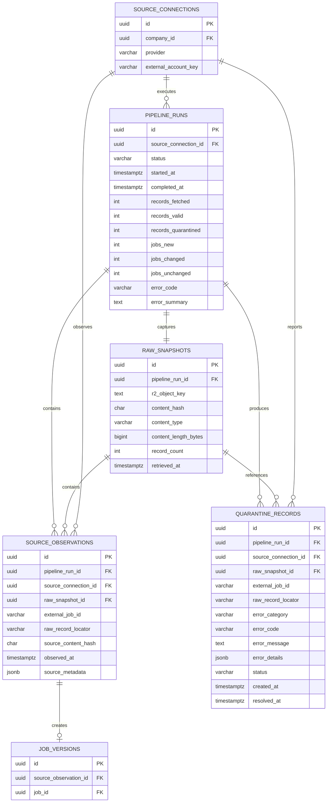

# OpenRole Observatory - Data Model

## 1. Purpose

This document defines the initial PostgreSQL data model for OpenRole Observatory.

The model is designed to support:

- direct-source job ingestion;
- source lineage;
- immutable job history;
- idempotent repeated ingestion;
- source-specific configuration;
- pipeline observability;
- quarantine handling;
- future multi-source expansion;
- future analytical processing.

The model should preserve a clear distinction between:

```text
Source configuration
Raw source observations
Canonical jobs
Historical job versions
Pipeline execution metadata
Invalid/quarantined records
```

Phase 1 supports Greenhouse only, but the schema must not assume Greenhouse is the only future source.

---

## 2. Modeling Principles

### 2.1 Stable identity is separate from observed state

A job listing has a stable identity:

```text
Job
```

Its fields may change over time:

```text
JobVersion
```

Example:

```text
Job
ID: job_123

Version 1
Title: Backend Engineer
Location: Remote

Version 2
Title: Backend Engineer
Location: Berlin — Hybrid
```

The job remains the same logical source listing.

The version captures what OpenRole observed at a particular point in time.

---

### 2.2 Raw data is not the canonical model

Cloudflare R2 preserves the original source response.

PostgreSQL stores metadata pointing to that raw snapshot.

Raw source payloads should not become the application's primary query model.

---

### 2.3 Every source-derived record should be traceable

A job version should be traceable through:

```text
JobVersion
    ↓
SourceObservation
    ├──→ RawSnapshot → R2 object
    └──→ PipelineRun → SourceConnection
```

This lineage is a core requirement.

---

### 2.4 Source-specific fields should not dominate the canonical schema

Fields common across ATS platforms belong in canonical columns.

Fields that are source-specific may be preserved in:

- raw R2 snapshots;
- limited JSONB metadata;
- source-specific mapping logic.

Do not add a new canonical column for every provider-specific field.

---

### 2.5 Historical versions are immutable

Once a `job_version` is created, its source-derived content should not be edited.

If later processing discovers that a transformation was wrong, the preferred approach is:

```text
Fix transformation logic
→ replay raw source observation
→ generate corrected canonical state
```

rather than silently modifying historical records without traceability.

---

## 3. Primary Entities

The initial model contains the following core entities:

```text
companies
source_connections
pipeline_runs
raw_snapshots
source_observations

jobs
job_versions

quarantine_records
```

Future entities may include:

```text
skills
job_skill_links
job_locations
duplicate_clusters
saved_searches
webhook_endpoints
webhook_deliveries
```

These are not required for Phase 1 unless explicitly introduced later.

Phase 2 Task 24 adds `job_change_events`, `job_lifecycle_events`, and current
absence state on `jobs`. Task 25 implements pure field comparison, and Task 26
persists change events atomically with changed-job version transitions. Task 27
validates durable presence evidence. Task 28 records first absence state and
`absence_detected` events atomically, while keeping Jobs `observed`. Task 29 confirms
the second safe absence with `not_observed_confirmed`. Task 30 handles present-state
reset and reappearance. Task 31 integrates them into SourceSyncService before
terminal finalization, under the source lock. Lifecycle counts and explicit skip
reasons are returned through the sync result rather than new PipelineRun columns.
Task 32 exposes current jobs, version/change/lifecycle histories, and safe source
health through read-only administrative APIs. Task 33 verifies those histories
end to end and commits normal-sync lifecycle state/events together with successful
run finalization. Canonical record processing remains independently durable.

---

## 4. `companies`

Represents an employer whose jobs OpenRole observes.

Example:

```text
Example Technologies GmbH
```

### Columns

```text
id                  UUID PK
name                VARCHAR NOT NULL
slug                VARCHAR NOT NULL
domain              VARCHAR NULL
careers_url         TEXT NULL

is_active           BOOLEAN NOT NULL DEFAULT TRUE

created_at          TIMESTAMPTZ NOT NULL
updated_at          TIMESTAMPTZ NOT NULL
```

### Constraints

```text
UNIQUE(slug)
```

Domain uniqueness should not necessarily be enforced initially because:

- several legal entities may share a parent domain;
- company domains may change;
- some employers use external careers domains.

---

## 5. `source_connections`

Represents a configured external ATS source for a company.

Example:

```text
Company:
Example Technologies GmbH

Provider:
Greenhouse

Board token:
exampletechnologies
```

The name `source_connections` is intentionally broader than:

```text
greenhouse_sources
```

because future providers should use the same concept.

### Columns

```text
id                    UUID PK
company_id            UUID FK → companies.id

provider              VARCHAR NOT NULL
external_account_key  VARCHAR NOT NULL

configuration         JSONB NOT NULL DEFAULT '{}'

is_active             BOOLEAN NOT NULL DEFAULT TRUE

last_successful_sync_at TIMESTAMPTZ NULL
last_attempted_sync_at  TIMESTAMPTZ NULL

created_at            TIMESTAMPTZ NOT NULL
updated_at            TIMESTAMPTZ NOT NULL
```

### Example

```json
{
  "provider": "greenhouse",
  "external_account_key": "exampletechnologies",
  "configuration": {
    "include_content": true
  }
}
```

Do not place secrets in `configuration` unless encrypted storage is introduced.

For public Greenhouse boards, credentials are not required.

### Constraints

```text
UNIQUE(provider, external_account_key)
```

This prevents the same external source from being configured multiple times accidentally.

---

## 6. Provider Values

Initial provider:

```text
greenhouse
```

Future:

```text
lever
ashby
workable
custom
```

Whether this uses:

```text
PostgreSQL ENUM
```

or:

```text
VARCHAR + application validation
```

should be decided conservatively.

For an evolving integration list, VARCHAR with application-level validation is often easier to extend without database enum migrations.

---

## 7. `pipeline_runs`

Represents one ingestion attempt against one source connection.

Every scheduled or manual sync creates exactly one pipeline-run record.

### Columns

```text
id                    UUID PK
source_connection_id  UUID FK → source_connections.id

status                VARCHAR NOT NULL

started_at            TIMESTAMPTZ NOT NULL
completed_at          TIMESTAMPTZ NULL

records_fetched       INTEGER NOT NULL DEFAULT 0
records_valid         INTEGER NOT NULL DEFAULT 0
records_quarantined   INTEGER NOT NULL DEFAULT 0

jobs_new              INTEGER NOT NULL DEFAULT 0
jobs_changed          INTEGER NOT NULL DEFAULT 0
jobs_unchanged        INTEGER NOT NULL DEFAULT 0

error_code            VARCHAR NULL
error_summary         TEXT NULL

created_at            TIMESTAMPTZ NOT NULL
```

### Status values

```text
pending
running
completed
completed_with_errors
failed
```

### Important rule

A run with:

```text
records_fetched = 0
status = completed
```

means:

> The source was successfully checked and no jobs were returned.

A run with:

```text
status = failed
```

means:

> The source could not be reliably evaluated.

These must never be treated as equivalent.

---

## 8. `raw_snapshots`

Represents the raw response captured from the source before normalization.

The actual payload lives in R2.

The database stores metadata and lineage.

### Columns

```text
id                    UUID PK
pipeline_run_id       UUID FK → pipeline_runs.id

r2_object_key         TEXT NOT NULL

content_hash          CHAR(64) NOT NULL
content_type          VARCHAR NOT NULL
content_length_bytes  BIGINT NULL

record_count          INTEGER NULL

retrieved_at          TIMESTAMPTZ NOT NULL

created_at            TIMESTAMPTZ NOT NULL
```

### Constraints

```text
UNIQUE(pipeline_run_id)
UNIQUE(r2_object_key)
```

Phase 1 assumes one primary raw response snapshot per run.

If providers later require pagination with multiple page objects, this may evolve into:

```text
one pipeline run
→ many raw snapshots
```

The schema should not make such an evolution impossible.

---

## 9. `source_observations`

Represents one observed source record during one successful pipeline run.

This is the bridge between:

```text
raw provider record
```

and:

```text
canonical job version
```

Example:

```text
Pipeline run:
run_123

Provider:
Greenhouse

External job ID:
456789
```

### Columns

```text
id                    UUID PK
pipeline_run_id       UUID FK → pipeline_runs.id
source_connection_id  UUID FK → source_connections.id

external_job_id       VARCHAR NOT NULL

raw_snapshot_id       UUID FK → raw_snapshots.id
raw_record_locator    VARCHAR NULL

source_content_hash   CHAR(64) NULL

observed_at           TIMESTAMPTZ NOT NULL

source_metadata       JSONB NOT NULL DEFAULT '{}'

created_at            TIMESTAMPTZ NOT NULL
```

### Why this entity exists

Without `source_observations`, the application would have difficulty answering:

> Which exact source observation created this job version?

A pipeline run may contain many jobs.

A raw snapshot may contain many records.

The observation identifies the specific external record inside that source snapshot.

One pipeline run may therefore have many source observations, while one observation
belongs to exactly one run, raw snapshot, and source connection. The database
prevents duplicate observations of the same external job within one run, but the
same external job may be observed again in every later run.

`source_content_hash` hashes one provider-native record using SHA-256 over its
decoded JSON with sorted keys, compact separators, UTF-8 encoding, and no
canonical mapping. It is different from the whole-response
`raw_snapshots.content_hash` and the normalized material-content
`job_versions.content_hash`.

---

## 10. `raw_record_locator`

Because a raw R2 object may contain a full array of jobs, `raw_record_locator` identifies where the source record can be found.

Possible value:

```text
jobs[17]
```

or:

```text
external_job_id=456789
```

The locator is primarily diagnostic.

OpenRole should not rely on array position as a permanent business identifier.

The stable source identity remains:

```text
source_connection_id
+
external_job_id
```

---

## 11. `jobs`

Represents the stable identity of a source job listing.

This table should contain identity and lifecycle fields, not a duplicate copy of every versioned field.

### Columns

```text
id                    UUID PK
company_id            UUID FK → companies.id
source_connection_id  UUID FK → source_connections.id

external_job_id       VARCHAR NOT NULL

current_version_id    UUID NULL
                      FK → job_versions.id
                      added after circular FK strategy is resolved

first_seen_at         TIMESTAMPTZ NOT NULL
last_seen_at          TIMESTAMPTZ NOT NULL

lifecycle_status      VARCHAR NOT NULL DEFAULT 'observed'

no_longer_observed_at TIMESTAMPTZ NULL
reappeared_at         TIMESTAMPTZ NULL

consecutive_absent_runs INTEGER NOT NULL DEFAULT 0
absence_first_detected_at TIMESTAMPTZ NULL

created_at            TIMESTAMPTZ NOT NULL
updated_at            TIMESTAMPTZ NOT NULL
```

### Stable uniqueness

```text
UNIQUE(source_connection_id, external_job_id)
```

This is one of the most important constraints in the entire system.

It prevents duplicate logical jobs when an unchanged source is ingested repeatedly.

---

## 12. Job Lifecycle Status

Current values are:

```text
observed
not_observed
```

Reappearance is an event; after reappearing the current status is `observed`.
Phase 2 does not add `reappeared` or `absence_detected` as permanent statuses.

Task 30 resets tentative absence when a safe run proves presence. Confirmed
reappearance requires successful canonical processing, excluding an observation
later quarantined at the same snapshot/locator. It sets `reappeared_at` to the
run's snapshot retrieval time while preserving `no_longer_observed_at` as the
most recent confirmed absence timestamp. Freshness remains owned by record
processing; lifecycle reconciliation does not modify `last_seen_at`.

Phase 1 mainly requires:

```text
first_seen_at
last_seen_at
```

Detailed closure confirmation belongs to later phases.

---

## 13. `job_versions`

Represents the canonical state of a job after normalization.

Each materially changed canonical state creates a new immutable version.

### Columns

```text
id                    UUID PK
job_id                UUID FK → jobs.id
source_observation_id UUID FK → source_observations.id

version_number        INTEGER NOT NULL

content_hash          CHAR(64) NOT NULL

title                 TEXT NOT NULL
description           TEXT NULL

location_text         TEXT NULL
city                  VARCHAR NULL
region                VARCHAR NULL
country_code          CHAR(2) NULL

workplace_type        VARCHAR NULL
employment_type       VARCHAR NULL

salary_min            NUMERIC(14,2) NULL
salary_max            NUMERIC(14,2) NULL
salary_currency       CHAR(3) NULL
salary_period         VARCHAR NULL

source_url            TEXT NOT NULL

source_published_at   TIMESTAMPTZ NULL
source_updated_at     TIMESTAMPTZ NULL

effective_from        TIMESTAMPTZ NOT NULL
effective_to          TIMESTAMPTZ NULL

is_current            BOOLEAN NOT NULL DEFAULT TRUE

canonical_metadata    JSONB NOT NULL DEFAULT '{}'

created_at            TIMESTAMPTZ NOT NULL
```

### Constraints

```text
UNIQUE(job_id, version_number)
UNIQUE(job_id, content_hash)
```

The second constraint assumes one identical canonical content state should not generate multiple versions.

If the same old state reappears later and temporal recurrence needs to be represented separately, this constraint may need reevaluation.

For Phase 1, preventing duplicate identical versions is desirable.

Every persisted job version requires one source observation. The foreign key is
unique, enforcing that one observation produces zero or one version: unchanged
observations remain valuable freshness evidence without duplicating canonical
history.

Source-derived `job_versions` content is treated as immutable by the application.
Later services must create a new version for changed canonical content instead of
editing a historical version in place.

---

## 14. Why `jobs` and `job_versions` are separate

Weak design:

```text
jobs
title
description
location
...
```

with rows overwritten whenever the source changes.

That loses historical state.

Better design:

```text
jobs
→ stable identity

job_versions
→ observed state over time
```

This allows:

```sql
SELECT *
FROM job_versions
WHERE job_id = :job_id
ORDER BY version_number;
```

to reconstruct the listing history.

---

## 15. Version Creation Rules

When a job is observed:

### New source job

```text
No jobs row exists
        ↓
Create jobs row
        ↓
Create job_versions version 1
        ↓
Set current_version_id
```

### Existing job with identical content hash

```text
Existing jobs row
        ↓
Hash matches current version
        ↓
Do not create version
        ↓
Update last_seen_at
```

### Existing job with changed content hash

```text
Existing jobs row
        ↓
Hash differs
        ↓
Set old version:
is_current = false
effective_to = observed_at

Create new version:
version_number + 1
is_current = true
effective_from = observed_at

Update jobs.current_version_id
Update jobs.last_seen_at
```

These operations should happen transactionally.

---

## 16. Version Numbering

Version numbering is per job:

```text
Job A
v1
v2
v3

Job B
v1
v2
```

Version numbers are not globally unique.

Database ID remains the global identifier.

---

## 17. Effective Time

Use:

```text
effective_from
effective_to
```

to represent when OpenRole observed that version as current.

This is not necessarily the time the employer changed the listing.

OpenRole only knows:

> When did our system observe this state?

Example:

```text
Employer changes job at 10:03

OpenRole polls at 12:00

effective_from = 12:00
```

The system should not claim the employer changed it exactly at 12:00.

This is an important semantic distinction.

---

## 18. Source Timestamps

Some ATS providers may provide:

```text
published_at
updated_at
```

Preserve them separately as:

```text
source_published_at
source_updated_at
```

Do not substitute them for:

```text
first_seen_at
last_seen_at
effective_from
```

These represent different facts.

---

## 19. Content Hash

Each job version should have a deterministic SHA-256 hash derived from normalized source content.

Example canonical hash input:

```json
{
  "title": "Backend Engineer",
  "description": "...",
  "location_text": "Berlin",
  "city": "Berlin",
  "region": null,
  "country_code": "DE",
  "workplace_type": "hybrid",
  "employment_type": "full_time",
  "salary_min": "65000.00",
  "salary_max": "80000.00",
  "salary_currency": "EUR",
  "salary_period": "year",
  "source_url": "..."
}
```

Before hashing:

- build an explicit material-content payload containing `title`, `description`,
  location fields, workplace and employment type, salary fields, `source_url`,
  and `canonical_metadata`;
- exclude `external_job_id`, `source_published_at`, and `source_updated_at` because
  identity and source timestamps do not independently represent material content;
- preserve null fields explicitly as JSON `null`;
- sort dictionary keys recursively and encode compact JSON as UTF-8;
- serialize enum values rather than Python enum names;
- normalize finite `Decimal` values to non-exponent strings without converting
  through binary floating point;
- normalize any future hash-participating datetime to UTC ISO 8601 and reject
  naive datetimes;
- treat the outer `departments` and `offices` metadata collections as unordered,
  while preserving order for other lists;
- perform no additional whitespace or HTML normalization during hashing.

These rules define Phase 1 hash semantics v1. Changing the included fields or
normalization rules later may require explicit hash versioning or a data migration.

The material content hash is not job identity. Logical identity comes from the
source connection together with the external job ID.

Hash behavior must be covered by tests.

---

## 20. `quarantine_records`

Represents records that could not be safely normalized or processed.

### Columns

```text
id                    UUID PK
pipeline_run_id       UUID FK → pipeline_runs.id
source_connection_id  UUID FK → source_connections.id
raw_snapshot_id       UUID FK → raw_snapshots.id

external_job_id       VARCHAR NULL
raw_record_locator    VARCHAR NULL

error_category        VARCHAR NOT NULL
error_code            VARCHAR NULL
error_message         TEXT NOT NULL

error_details         JSONB NOT NULL DEFAULT '{}'

status                VARCHAR NOT NULL DEFAULT 'open'

created_at            TIMESTAMPTZ NOT NULL
resolved_at           TIMESTAMPTZ NULL
```

### Possible statuses

```text
open
resolved
ignored
replayed
```

Phase 1 may only require:

```text
open
resolved
```

Phase 1 implements only those two values. Database constraints keep status and
resolution time consistent:

```text
open     → resolved_at IS NULL
resolved → resolved_at IS NOT NULL
```

The source lineage and diagnostic fields are historical evidence. Only the
explicit status and resolution timestamp are intended to change as a future
resolution workflow is introduced.

---

## 21. Quarantine Philosophy

Quarantine should represent:

> We received source data but could not safely transform it.

It should not be used for:

```text
network timeout
database outage
R2 failure
```

Those are pipeline-level failures, not bad-record failures.

Example quarantine cases:

```text
missing external job ID
malformed timestamp
unsupported field shape
invalid salary value
unexpected required null
mapper failure for one record
```

Every quarantine record points directly to its pipeline run, source connection,
and raw snapshot. `external_job_id` and `raw_record_locator` remain nullable
because malformed input may not contain a usable identifier or locator.

Quarantine does not require a `job_id`: an invalid record may never become a
canonical job. It also does not require `source_observation_id`, because source
validation may fail before a valid observation can be recorded. The raw snapshot
and locator preserve error-path lineage without copying the full source payload
into PostgreSQL.

---

## 22. Optional `pipeline_run_errors`

If pipeline-level failures need more than:

```text
error_code
error_summary
```

a separate table may later be introduced:

```text
pipeline_run_errors

id
pipeline_run_id
error_type
message
details
created_at
```

This is not required in Phase 1 unless error volume justifies it.

---

## 23. `source_observations` and Job Versions

A source observation should ideally map to one canonical job version when a change occurs.

However, an unchanged observation may not create a new version.

Therefore:

```text
SourceObservation
```

exists independently of:

```text
JobVersion
```

Relationship:

```text
one source observation
→ zero or one new job version
```

This is important because every polling run still represents an observation even if content did not change.

---

## 24. Do We Store Every Observation?

There are two valid approaches.

### Option A — store every source observation

Advantages:

- complete observation history;
- easier freshness analysis;
- precise lineage;
- strong auditability.

Disadvantages:

- more database rows.

### Option B — store observations only for changed/new records

Advantages:

- smaller database.

Disadvantages:

- weaker observation history;
- last-seen lineage becomes less detailed.

For OpenRole, prefer:

> Store every source observation.

Job data volume is manageable for the initial project, and this provides stronger data-engineering value.

---

## 25. Observation Example

Suppose a job remains unchanged across three runs.

```text
Run 1
SourceObservation A
JobVersion 1 created

Run 2
SourceObservation B
No version created

Run 3
SourceObservation C
No version created
```

The system now knows:

```text
Version unchanged
but
source successfully observed the job three times
```

That improves freshness tracking.

---

## 26. Phase 2 Task 24: Change and Lifecycle Schema

`JobVersion` stores canonical historical state. `JobChangeEvent` stores a derived
explanation of the difference between two versions. Lifecycle evidence lives in
a separate table because disappearance and reappearance can occur without any
canonical content change or new version.

### Current absence state on `jobs`

- `consecutive_absent_runs`: number of consecutive usable successful source
  synchronizations missing this job; integer, not null, default `0`.
- `absence_first_detected_at`: observation time of the first run in the current
  absence sequence; nullable timezone-aware timestamp.

The database check `ck_jobs_consecutive_absent_runs_non_negative` prevents a
negative count. These fields are mutable current state, kept on Job so later
reconciliation can read the current sequence without reconstructing event/run
history. Later presence behavior will reset them to `0` and NULL. Task 24 does
not increment or reset them automatically.

### `job_change_events`

```text
job_change_events

id                  UUID PK
job_id              UUID NOT NULL FK → jobs.id
from_version_id     UUID NOT NULL FK → job_versions.id
to_version_id       UUID NOT NULL FK → job_versions.id

field_name          VARCHAR NOT NULL
change_type         VARCHAR NOT NULL

old_value           JSONB NULL
new_value           JSONB NULL

detected_at         TIMESTAMPTZ NOT NULL
created_at          TIMESTAMPTZ NOT NULL DEFAULT now()
```

`FieldChangeType` defines `added`, `removed`, and `modified` in Python. Field names
and change types remain VARCHAR in PostgreSQL; no field-name ENUM is introduced.

Both version references are required to identify the exact before/after states.
Application invariant enforced by the changed-job service:
`from_version.job_id == to_version.job_id == event.job_id`. Simple foreign keys
enforce existence, not that equality; no triggers or composite keys are added.

JSONB preserves strings, numbers, booleans, arrays, and structured metadata.
The ORM uses `JSONB(none_as_null=True)`: Python `None` stores SQL NULL (no value
represented), while `sqlalchemy.JSON.NULL` explicitly stores JSON null. Both
decode to Python `None` on read; SQL `IS NULL` and `jsonb_typeof()` distinguish
them. This is a storage convention, not a field-diff rule. Task 26 persists Task
25's JSON-compatible values unchanged, including full old/new description text
and normalized Decimal salary strings (for example, `"65000"`). The schema has
no description-specific behavior.

`detected_at` is supplied by the caller, intended to be the new version's
`effective_from`; `created_at` is database row creation time.

`uq_job_change_events_from_to_field` enforces
`UNIQUE(from_version_id, to_version_id, field_name)`: a retry cannot duplicate a
field event for the same transition, but several different fields may change.
Indexes are `(job_id, detected_at)` and `(to_version_id)`. The unique index already
supports lookups beginning with `from_version_id` and version-pair lookups.

Relationships: `Job.change_events`, `JobVersion.outgoing_change_events`,
`JobVersion.incoming_change_events`, and `JobChangeEvent.job/from_version/to_version`.
Explicit `foreign_keys=` on each version relationship disambiguates the two
foreign keys targeting `job_versions`.

### `job_lifecycle_events`

```text
id                  UUID PK
job_id              UUID NOT NULL FK → jobs.id
pipeline_run_id     UUID NOT NULL FK → pipeline_runs.id
event_type          VARCHAR NOT NULL
occurred_at         TIMESTAMPTZ NOT NULL
previous_status     VARCHAR NULL
new_status          VARCHAR NULL
metadata            JSONB NOT NULL DEFAULT '{}'
created_at          TIMESTAMPTZ NOT NULL DEFAULT now()
```

`JobLifecycleEventType` defines `absence_detected`, `not_observed_confirmed`, and
`reappeared` in Python. No redundant `first_observed` event is introduced;
`jobs.first_seen_at` already preserves first observation.

The run reference preserves provenance. Lifecycle services must ensure the run
belongs to the job's source and is usable as lifecycle evidence. `occurred_at`
represents the source observation time, intended to come from snapshot retrieval
time, independently of the database `created_at` timestamp.

For a first-absence event, use `previous_status = observed` and
`new_status = observed`, explicitly recording that permanent status has not
changed. Both columns allow NULL when status context is unavailable.

Task 30 inserts `reappeared` with `previous_status = not_observed` and
`new_status = observed` in the same transaction as the Job's lifecycle update.
Its `event_metadata` contains the previous absence count and prior confirmed
absence timestamp; the latter is retained on Job. Unsafe or non-successful runs
cannot apply this transition. Repeated invocation naturally becomes a no-op.

Task 29 inserts `not_observed_confirmed` with `previous_status = observed` and
`new_status = not_observed`, atomically with the counter advancing from 1 to 2
and `no_longer_observed_at` becoming `RawSnapshot.retrieved_at`. That timestamp
records OpenRole's confirming observation, not the exact employer removal time.
The first-absence timestamp and freshness remain unchanged. The Phase 2 setting
`JOB_ABSENCE_CONFIRMATION_RUNS` accepts only 2: there is no per-run accounting for
event-free intermediate increments at larger thresholds. Checking existing
absence events for the current run prevents that run from counting twice,
including immediately after Task 28 or after a later lifecycle cycle.

The Python attribute `event_metadata` maps to SQL column `metadata`, since
SQLAlchemy reserves the class attribute `metadata`. Use small contextual values
such as absence count and confirmation threshold, not full job payloads.

`uq_job_lifecycle_events_job_run_type` enforces
`UNIQUE(job_id, pipeline_run_id, event_type)`. It protects retries within a run
while allowing the same event type in later disappearance/reappearance cycles.
Indexes are `(job_id, occurred_at)` and `(pipeline_run_id)`.

Relationships: `Job.lifecycle_events`, `PipelineRun.lifecycle_events`, and
`JobLifecycleEvent.job/pipeline_run`.

### History retention and migration

Both event types use existing UUIDv4 defaults and restrictive foreign keys.
Disabling a source does not delete history. No delete cascades, ORM hooks,
automatic events, read APIs, or arbitrary event-write schemas are introduced.
Event rows are historically immutable by application convention, as canonical
version content already is; PostgreSQL does not prohibit explicit administrative
updates with triggers.

Revision `55c52c19c673` follows Phase 1 head `3e7f3cd24003`. It adds the job columns
with a retained server default of `0`, safely initializing existing jobs without
changing Phase 1 content or lineage, then creates the event tables and indexes.
Downgrade drops only the two event tables and the new job check/columns. Any
Task 24 event data is lost on downgrade; Phase 1 rows and versions remain.

---

## 27. Future `job_locations`

Phase 1 may store location fields directly on `job_versions`.

Later, one listing may need multiple locations.

At that point introduce:

```text
job_version_locations
```

or:

```text
locations
job_version_location_links
```

Do not normalize this prematurely unless Greenhouse fixtures demonstrate that multiple locations are already important for V1.

---

## 28. Future Skills Model

Do not add:

```text
skills
job_skills
```

in Phase 1.

Skill extraction is enrichment.

The source description should first be preserved correctly.

Later:

```text
JobVersion
    ↓
SkillExtraction
    ↓
JobSkill
```

should be traceable to the version that produced it.

---

## 29. Future International Hiring Evidence

Later enrichment may introduce:

```text
job_enrichments

id
job_version_id
enrichment_type
provider
model
result
evidence
created_at
```

Example:

```text
type:
international_hiring

result:
RELOCATION_MENTIONED
```

This should not be stored directly on `jobs` because:

- enrichment may change;
- models may change;
- different job versions may contain different evidence.

Not Phase 1.

---

## 30. UUID Strategy

Use UUIDs for application-generated identifiers.

Examples:

```text
companies.id
jobs.id
job_versions.id
pipeline_runs.id
```

Recommended:

```text
UUIDv7
```

if the selected Python/PostgreSQL tooling supports it conveniently.

UUIDv7 has useful ordering characteristics while remaining globally unique.

UUIDv4 is also acceptable if simplicity is preferred.

Do not block the project over UUID version choice.

External source IDs remain strings because ATS providers may use different identifier formats.

---

## 31. Timestamp Strategy

All persisted timestamps should use:

```text
TIMESTAMPTZ
```

Store timestamps in UTC.

Do not store naive local timestamps.

The UI may convert timestamps into a user's local timezone later.

Fields such as:

```text
created_at
updated_at
observed_at
started_at
completed_at
```

must have clear semantic meanings.

Avoid generic timestamp fields whose meaning is ambiguous.

---

## 32. Money Representation

Salary values should use:

```text
NUMERIC
```

not floating-point.

Example:

```text
NUMERIC(14,2)
```

Fields:

```text
salary_min
salary_max
```

Require:

```text
salary_currency
```

when salary exists.

Currency should use an ISO 4217 code:

```text
USD
EUR
GBP
PHP
```

Salary period may use values such as:

```text
hour
day
week
month
year
```

Unknown period remains null rather than guessed.

---

## 33. Index Strategy

Indexes should be introduced based on expected access patterns.

### `source_connections`

```text
UNIQUE(provider, external_account_key)
INDEX(company_id)
INDEX(is_active)
```

### `pipeline_runs`

```text
INDEX(source_connection_id, started_at DESC)
INDEX(status)
```

### `source_observations`

```text
UNIQUE(pipeline_run_id, external_job_id)
INDEX(raw_snapshot_id)
INDEX(source_connection_id, external_job_id)
INDEX(observed_at)
```

The unique constraint's leading `pipeline_run_id` also supports lookups by run,
so a separate single-column run index would be redundant.

### `jobs`

Critical:

```text
UNIQUE(source_connection_id, external_job_id)
```

Additional:

```text
INDEX(company_id)
INDEX(last_seen_at DESC)
INDEX(lifecycle_status)
```

### `job_versions`

Critical:

```text
UNIQUE(job_id, version_number)
```

Additional:

```text
INDEX(job_id, effective_from DESC)
INDEX(job_id, is_current)
INDEX(content_hash)
```

### `quarantine_records`

```text
INDEX(pipeline_run_id)
INDEX(source_connection_id)
INDEX(raw_snapshot_id)
INDEX(status)
INDEX(error_category)
```

Avoid adding indexes to every column.

Indexes have write and storage costs.

---

## 34. Current Version Constraint

Ideally:

> A job should have at most one `job_version` where `is_current = TRUE`.

PostgreSQL can enforce this with a partial unique index:

```sql
CREATE UNIQUE INDEX uq_job_versions_current
ON job_versions(job_id)
WHERE is_current = TRUE;
```

This is preferable to relying only on application logic.

---

## 35. Circular Reference: `jobs.current_version_id`

There is a circular relationship:

```text
jobs.current_version_id
→ job_versions.id

job_versions.job_id
→ jobs.id
```

This is manageable.

Potential strategies:

### Option A

Create `jobs` first without `current_version_id`.

Create `job_versions`.

Add the foreign key afterward through migration.

### Option B

Do not store `current_version_id`.

Query:

```text
job_versions
WHERE job_id = ?
AND is_current = true
```

For Phase 1, Option B is arguably simpler.

Recommendation:

> Start without `current_version_id`.

The partial unique index makes the current version easy to retrieve safely.

Add `current_version_id` only if query performance or implementation simplicity later justifies denormalization.

---

## 36. Recommended Simplified `jobs` Table

Given the previous decision:

```text
jobs

id
company_id
source_connection_id
external_job_id

first_seen_at
last_seen_at

lifecycle_status
no_longer_observed_at
reappeared_at
consecutive_absent_runs
absence_first_detected_at

created_at
updated_at
```

Current content always comes from:

```text
job_versions
WHERE is_current = true
```

This keeps the identity table clean.

---

## 37. Delete Behavior

Be conservative with cascading deletes.

### Company deletion

During development, deleting a company may cascade through:

```text
source_connections
jobs
pipeline_runs
```

but production retention requirements may later require soft deletion.

Do not design irreversible deletion casually once the product has users.

---

### Job version deletion

Historical job versions should generally not be deleted independently.

They belong to the lifecycle of a job.

---

### Raw snapshot deletion

Raw snapshots in R2 must not be deleted automatically merely because a normalized child record changes.

Retention should be explicit.

---

## 38. Soft Deletion

Phase 1 does not require soft deletion everywhere.

Use:

```text
is_active
```

for configurable resources such as:

```text
companies
source_connections
```

Historical ingestion records should remain immutable.

Avoid adding:

```text
deleted_at
```

to every table without a concrete requirement.

---

## 39. Data Retention

Initial recommendation:

```text
companies
retain

source_connections
retain while configured

pipeline_runs
retain

raw_snapshots
retain

source_observations
retain

jobs
retain

job_versions
retain

quarantine_records
retain until intentionally resolved/cleaned
```

This is practical while dataset size remains small.

Retention policies can evolve after storage growth becomes measurable.

---

## 40. Data Lineage Example

Suppose OpenRole displays:

```text
Location:
Berlin — Hybrid
```

Trace:

```text
job_versions.id = version_22
        ↓
source_observation_id = observation_991
        ↓
raw_snapshot_id = snapshot_102
        ↓
R2:
bronze/greenhouse/example/run=run_102/jobs.json
        ↓
Raw Greenhouse job ID:
456789
```

The same observation also carries `pipeline_run_id = run_102`; that run links to
the source connection and its company.

This should be reconstructable programmatically.

---

## 41. ERD - Core Domain

```mermaid
erDiagram

    COMPANIES {
        uuid id PK
        varchar name
        varchar slug
        varchar domain
        text careers_url
        boolean is_active
        timestamptz created_at
        timestamptz updated_at
    }

    SOURCE_CONNECTIONS {
        uuid id PK
        uuid company_id FK
        varchar provider
        varchar external_account_key
        jsonb configuration
        boolean is_active
        timestamptz last_successful_sync_at
        timestamptz last_attempted_sync_at
        timestamptz created_at
        timestamptz updated_at
    }

    JOBS {
        uuid id PK
        uuid company_id FK
        uuid source_connection_id FK
        varchar external_job_id
        timestamptz first_seen_at
        timestamptz last_seen_at
        varchar lifecycle_status
        timestamptz no_longer_observed_at
        timestamptz reappeared_at
        int consecutive_absent_runs
        timestamptz absence_first_detected_at
        timestamptz created_at
        timestamptz updated_at
    }

    JOB_VERSIONS {
        uuid id PK
        uuid job_id FK
        uuid source_observation_id FK
        int version_number
        char content_hash
        text title
        text description
        text location_text
        varchar city
        varchar region
        char country_code
        varchar workplace_type
        varchar employment_type
        numeric salary_min
        numeric salary_max
        char salary_currency
        varchar salary_period
        text source_url
        timestamptz source_published_at
        timestamptz source_updated_at
        timestamptz effective_from
        timestamptz effective_to
        boolean is_current
        jsonb canonical_metadata
        timestamptz created_at
    }

    COMPANIES ||--o{ SOURCE_CONNECTIONS : has
    COMPANIES ||--o{ JOBS : owns
    SOURCE_CONNECTIONS ||--o{ JOBS : provides
    JOBS ||--o{ JOB_VERSIONS : has
```



---

## 42. ERD - Ingestion and Lineage



---

## 43. Phase 1 Tables

Only the following are required initially:

```text
companies
source_connections
pipeline_runs
raw_snapshots
source_observations
jobs
job_versions
quarantine_records
```

Do not add:

```text
users
saved searches
subscriptions
skills
webhooks
duplicate clusters
AI enrichments
analytics marts
```

until later phases require them.

---

## 44. Phase 1 Example

Configured company:

```text
company:
Acme GmbH

source:
greenhouse/acme
```

Greenhouse returns:

```text
Job 1001
Backend Engineer
Berlin
```

### First run

Create:

```text
pipeline_run #1
raw_snapshot #1
source_observation #1
job #1
job_version #1
```

Job state:

```text
first_seen_at = 2026-09-28 10:00 UTC
last_seen_at = 2026-09-28 10:00 UTC
```

Version:

```text
version_number = 1
is_current = true
```

---

## 45. Second Identical Observation

At:

```text
2026-09-28 13:00 UTC
```

Greenhouse still returns the same content.

Create:

```text
pipeline_run #2
raw_snapshot #2
source_observation #2
```

Do NOT create:

```text
job #2
job_version #2
```

Update:

```text
job.last_seen_at
```

Result:

```text
jobs_unchanged += 1
```

---

## 46. Third Changed Observation

Greenhouse changes:

```text
Berlin
```

to:

```text
Berlin — Hybrid
```

Create:

```text
pipeline_run #3
raw_snapshot #3
source_observation #3
job_version #2
```

Update old version:

```text
version 1
is_current = false
effective_to = observation time
```

Create:

```text
version 2
is_current = true
effective_from = observation time
```

Update:

```text
job.last_seen_at
```

Result:

```text
jobs_changed += 1
```

---

## 47. Invalid Observation

Suppose a Greenhouse record has no usable external job ID.

Create:

```text
source_observation
```

only if a meaningful source observation identity can be preserved.

Otherwise create:

```text
quarantine_record
```

referencing:

```text
pipeline_run
raw_snapshot
raw_record_locator
```

Do not create a canonical job.

Result:

```text
records_quarantined += 1
```

---

## 48. Transaction Boundary

For each valid source record, the canonical persistence operation should be atomic.

Conceptually:

```text
BEGIN

create source observation

find job by:
source_connection_id
+
external_job_id

if missing:
    create job
    create version 1

else:
    compare content hash

    if changed:
        close previous current version
        create next version

    update last_seen_at

COMMIT
```

If persistence fails:

```text
ROLLBACK
```

The pipeline then decides whether the record:

- can be quarantined;
- should be retried;
- or indicates a broader database failure.

---

## 49. Concurrency

Two ingestion runs for the same source connection should not update the same jobs concurrently.

Phase 1 should prevent:

```text
Run A
and
Run B
```

from processing the same source simultaneously.

Possible approaches:

- application-level run lock;
- PostgreSQL advisory lock;
- unique active-run constraint;
- scheduler-level locking.

Recommendation:

Use a PostgreSQL advisory lock keyed by `source_connection_id` or an equivalent simple database-backed lock.

Do not introduce Redis solely for locking.

---

## 50. Schema Evolution

Alembic should manage all PostgreSQL schema changes.

Rules:

- never manually modify production schema without a migration;
- migrations must be committed;
- destructive migrations require explicit review;
- schema changes should preserve historical data when possible.

Example:

```text
migrations/
001_initial_tables.py
002_add_job_version_history.py
003_add_quarantine_status.py
```

Actual filenames should follow Alembic conventions.

---

## 51. Seed Data

Development should include a small seed dataset containing:

```text
1–3 companies
Greenhouse source connections
sample jobs
sample pipeline runs
```

Seed data should not replace fixture-based pipeline tests.

Fixtures represent external source responses.

Seed data represents internal database state.

They serve different purposes.

---

## 52. Data Model Invariants

The following must always remain true.

### Invariant 1

A source job has at most one canonical `jobs` row per source connection.

Enforced through:

```text
UNIQUE(source_connection_id, external_job_id)
```

---

### Invariant 2

A job has at most one current version.

Enforced through a partial unique index.

---

### Invariant 3

A version's source-derived content is immutable after creation.

---

### Invariant 4

An unchanged observation does not create a new job version.

---

### Invariant 5

Every created job version is traceable to a source observation.

---

### Invariant 6

Every source observation is traceable to a pipeline run and raw snapshot.

---

### Invariant 7

A failed pipeline run cannot cause existing jobs to be marked absent. Normal
source synchronization commits all lifecycle changes/events and successful
run/source finalization in one transaction. If any stage or commit fails, that
transaction rolls back before failed-run finalization. Previously committed
canonical versions/observations can remain; they are separate from absence
decisions. Standalone lifecycle services accept only successful completed runs
unless invoked internally with the verified running-run handoff and caller-owned
session.

---

### Invariant 8

Quarantined records remain discoverable and are never silently discarded.

---

## 53. Phase 1 Acceptance Criteria for the Data Model

The schema is sufficient for Phase 1 when it supports all of the following:

### Initial ingestion

```text
source job
→ jobs row
→ job_versions v1
```

### Repeated identical ingestion

```text
same source job
→ same jobs row
→ no new version
→ new source observation
→ last_seen_at updated
```

### Changed ingestion

```text
same source ID
+
new content hash
→ same jobs row
→ new immutable version
```

### Invalid source record

```text
bad record
→ quarantine
→ no invalid canonical job
```

### Data lineage

```text
job version
→ observation
→ pipeline run
→ raw R2 snapshot
```

### Source failure

```text
failed pipeline
→ existing jobs remain unchanged
```

---

## 54. Summary

The initial OpenRole data model is deliberately centered on four concepts:

```text
Identity
Observation
Version
Lineage
```

A `job` represents identity.

A `source_observation` represents a successful observation of that listing.

A `job_version` represents the normalized state observed at a particular time.

A `raw_snapshot` preserves the original provider response.

Together:

```text
Company
    ↓
Source Connection
    ↓
Pipeline Run
    ↓
Raw Snapshot
    ↓
Source Observation
    ↓
Job Versions
    ↑
   Job
```

This structure provides the foundation for:

- reliable ingestion;
- idempotency;
- historical job tracking;
- change detection;
- replayability;
- data provenance;
- future analytics.

Phase 1 should keep this model small and correct before adding enrichment, user features, or additional ATS providers.
