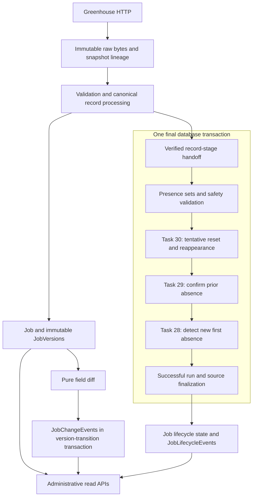

# OpenRole Observatory — Phase 2 Completion Report

Verification date: 2026-10-09 (Asia/Manila)

Status: **PASS — implementation and automated/manual verification complete.**
Developer understanding review remains pending; Phase 3 has not started.

## Summary

Phase 2 adds explainable field-level changes, conservative source-presence
reconciliation, first/confirmed absence, tentative reset, reappearance, source
health, and read-only historical APIs to the Phase 1 ingestion foundation.
JobVersions remain the canonical historical source of truth. JobChangeEvents
explain adjacent accepted versions. JobLifecycleEvents record observation-based
decisions independently of canonical content changes.

Task 33 found and fixed one material defect: earlier lifecycle batches could
commit before a later failure made their PipelineRun failed. Normal sync now
commits lifecycle changes/events and successful run/source finalization together.
[ADR 0001](adrs/0001-atomic-lifecycle-finalization.md) records the approved change.

## Architecture delivered



The source advisory lock spans acquisition, record processing, lifecycle, and
success/failure finalization. No application database transaction spans HTTP,
ObjectStorage I/O, or the entire synchronization. Independent canonical record
transactions can remain committed after a later sync failure. All lifecycle
changes from a failed final transaction roll back together. Failed status is
then recorded in a separate transaction while the source lock remains held.

## Requirement and gap audit

| Task | Implemented | Tested | Documented | Understood |
| --- | --- | --- | --- | --- |
| 24: schema foundation | PASS | PASS: schema/FK/uniqueness/migration suites | PASS: data model and Phase 2 | Developer review pending |
| 25: pure diff | PASS | PASS: all tracked fields, normalization, JSON distinctions, hash consistency, infrastructure-free import | PASS: Phase 2 diff contract | Developer review pending |
| 26: persisted changes | PASS | PASS: exact values, adjacent lineage, retries, rollback, hash/diff invariant | PASS: data model and Phase 2 | Developer review pending |
| 27: presence safety | PASS | PASS: observation/quarantine overlaps, identity recovery, unsafe membership, counts/lineage/handoff | PASS: Phase 2 presence contract | Developer review pending |
| 28: first absence | PASS | PASS: observed/count-one state, timestamps, same-run protection, rollback | PASS: Phase 2 | Developer review pending |
| 29: confirmation | PASS | PASS: second distinct safe run, fixed threshold, retry/replay safeguards, rollback | PASS: configuration, data model, Phase 2 | Developer review pending |
| 30: present-state reset/reappearance | PASS | PASS: tentative reset, valid return, quarantine-only restraint, multiple cycles, rollback | PASS: lifecycle case matrix | Developer review pending |
| 31: synchronization integration | PASS after hardening | PASS: exact order, shared transaction, failures before commit, lock lifetime, I/O boundaries | PASS: architecture and ADR | Developer review pending |
| 32: read APIs | PASS | PASS: realistic histories, errors, JSON/Decimal/timezones, pagination/ties, secrets, read-only checks | PASS: README and Phase 2 | Developer review pending |

Before Task 33, individual components and their focused tests were complete.
The gaps were an authoritative sync-to-API acceptance story, multiple-cycle
integration coverage, broader failure injection, explicit I/O transaction
checks, and formal closure. Those gaps are now covered. There was no accidental
Phase 3 scope expansion and no separate duplicate reconciliation algorithm.

### Phase 2 definition of done

| Requirement | Status and evidence |
| --- | --- |
| What versions has a job had? | PASS: authoritative v1/v2/v3 story and version API |
| Which fields changed? | PASS: exact workplace and four-field events, plus full diff suite |
| When were changes detected? | PASS: detected_at matches source observation/effective_from |
| Is a job currently observed? | PASS: observed/not_observed API and state-machine tests |
| Has it disappeared? | PASS: first safe absence/count-one event |
| Was absence confirmed conservatively? | PASS: distinct second safe run, unsafe/failure guards, same-run skip |
| Has it reappeared? | PASS: unchanged and changed returns, two confirmed cycles |
| Which run caused a lifecycle decision? | PASS: event UUID provenance matches each sync result |
| When was the source successfully checked? | PASS: latest failure preserves the older success timestamp |
| Are answers retrievable through stable APIs? | PASS: realistic API acceptance, Task 32 contracts, real curl checks |

External live-service checks are NOT RUN as stated below. Public UI, new
providers, authentication implementation, and analytics are NOT APPLICABLE to
Phase 2. There are no failed required automated acceptance checks.

## Verification results

The local Compose PostgreSQL volume was recreated as explicitly requested.
All schema construction used Alembic; no manual schema mutation was needed.

```bash
docker compose down -v
docker compose up -d postgres

# From backend/:
uv run alembic upgrade 3e7f3cd24003
uv run alembic current
uv run alembic upgrade head
uv run alembic current
uv run alembic heads
uv run alembic history
uv run pytest
uv run ruff check .
uv run ruff format --check .
uv run mypy
```

| Check | Result |
| --- | --- |
| Empty database → Phase 1 | PASS: `3e7f3cd24003` |
| Phase 1 → Phase 2 head | PASS: `55c52c19c673`, one head |
| Schema inspection | PASS: eight Phase 1 tables retained, two event tables added, absence count/timestamp present |
| Task 24 downgrade/re-upgrade | PASS: integration test preserves Phase 1 rows and backfills absence defaults |
| Clean full suite | 628 collected; **626 passed, 0 failed, 2 skipped**, 45.70 seconds |
| Ruff | PASS |
| Format check | PASS: 163 Python files |
| Mypy | PASS: 156 source files |
| Environment example | PASS: all Settings fields represented; POSTGRES_PORT is Compose-only |
| Real Uvicorn/curl inspection | PASS: all five Phase 2 endpoints returned HTTP 200 |
| Live Greenhouse | NOT RUN: gated external test skipped |
| Live R2 | NOT RUN: gated external test skipped |

There is one pre-existing Starlette TestClient/httpx deprecation warning. Normal
tests use stored fixtures/mocked transport and do not require external services.
Task 33 adds 21 collected test cases: 16 acceptance cases, four finalization
rollback cases, and one database-parameter redaction case. Existing failure and
ordering tests were updated to enforce the new shared transaction contract.

Focused checks also passed: the initial lifecycle/pipeline hardening selection
had 115 passing tests; the final lifecycle-sync/database selection had 22 passing
tests; the transaction-I/O/performance selection had two passing tests.

## Authoritative lifecycle scenario results

`tests/integration/ingestion/test_phase_two_acceptance.py` uses real PostgreSQL,
actual SourceSyncService, GreenhouseClient over httpx.MockTransport, filesystem
storage, validation/observation persistence, canonical versioning/change events,
lifecycle services, and the production read query services/routes.

The existing mapper injection point supplies explicit workplace/employment/salary
fixture fields. Production Greenhouse mapping still leaves those fields unknown;
this task does not introduce enrichment or salary/workplace extraction.

| Scenario | Exact verified result |
| --- | --- |
| Initial observation | Jobs 1001/1002 created with Version 1, observed/count 0, no lifecycle events |
| Unchanged sync | Two unchanged jobs; original version IDs retained; observations increase from 2 to 4; last_seen advances |
| Material change | Job 1001 workplace `remote → hybrid`; exactly one new version and one workplace event |
| Multiple fields | One new version; location_text modified, salary_min/salary_max/employment_type added |
| First absence | Job 1002 remains observed, count 1, first-absence timestamp/event set |
| Same-run counting protection | Explicit Task 29 invocation on that completed run confirms zero jobs and reports one already-applied skip |
| Tentative reset | Count becomes 0, first-absence timestamp clears, no reappeared event |
| Confirmed absence | Two distinct safe missing observations produce count 2/not_observed; first and confirming observation times stay separate |
| Same-content return | One reappeared event, no additional canonical version |
| Changed-content return | Title becomes `Returning Engineer II`; new version, title change, and reappeared event share coherent provenance |
| Multiple cycles | Two confirmed absence/reappearance cycles coexist, plus the earlier tentative-absence event |
| Safe partial run | Known quarantine ID protects presence and resets tentative absence; cannot confirm a not_observed job's return |
| Unsafe partial run | Unknown quarantine ID skips all lifecycle work across count 0/1/2 states; valid canonical change still persists |
| Failed source/processing | Timeout, 503, storage, malformed JSON, record database error, and event error fail the run with unchanged existing lifecycle state/event IDs |
| Empty successful board | Two observed jobs become count 1 after the first empty board, then count 2/not_observed after the second |
| Source isolation | Syncing/emptying source A preserves source B lifecycle state, versions, and empty lifecycle history |

The golden test stores first observations at 2026-10-01 12:00 UTC. Its first
confirmed cycle has absence on October 7, confirmation October 8, and same-content
return October 9. Its second cycle has absence October 10, confirmation October
11, and changed return October 12. These are deterministic fixture times, not
claims about employer actions or the execution date.

Every lifecycle event contains the exact PipelineRun UUID returned by the sync
that produced it. Event history for Job 1002 is:

```text
tentative absence
first absence → confirmation → unchanged reappearance
first absence → confirmation → changed reappearance
```

## Change intelligence and historical integrity

For Job 1001:

```text
Version 1: workplace_type = remote
Version 2: workplace_type = hybrid
FieldChange: modified, remote → hybrid
JobChangeEvent: same values, v1/v2 IDs, observation detected_at

Version 3:
location_text = Manila — Hybrid
salary_min = 65000.01
salary_max = 90000.99
employment_type = full_time
```

The diff engine and hash use the same material normalization. Unit tests cover
same content → same hash/empty diff and every tracked material change → different
hash/nonempty diff. A deliberately inconsistent hash with empty diff fails and
rolls back the transition. Event-insert failure also rolls back the old-version
closure, new version, change events, and last_seen update.

Acceptance checks verify every event's job matches both versions, transitions
advance by one version, and `(from_version_id, to_version_id, field_name)` has no
duplicates. Lifecycle-only transitions retain canonical fields and version
counts. An isolated transaction deletes derived change events and verifies
version history remains readable, then rolls that deletion back.

Lineage is verified as:

```text
Job → JobVersion → SourceObservation → RawSnapshot → PipelineRun → SourceConnection
Job → JobLifecycleEvent → PipelineRun → RawSnapshot / SourceConnection
```

Actual filesystem bytes hash to the stored RawSnapshot SHA-256. Observation
identity/run/snapshot references match their canonical version and source.

## Safety, atomicity, ordering, and locks

Presence evidence combines successfully canonicalized IDs and recoverable
quarantine IDs. Count/lineage mismatches fail as invariants. Any unidentified
quarantine makes membership incomplete and absence inference unsafe. Quarantine
identity proves presence, but not successful canonical content or confirmed
reappearance.

The tested order is:

```text
record processing → presence → Task 30 → Task 29 → Task 28 → finalization → commit
```

Reset/reappearance runs first so present jobs do not confirm absence.
Confirmation runs before new first absences so this run's first absence cannot
also become its second. Persisted per-run event checks provide an additional
guard against double counting/replay.

Standalone event-insert rollback tests cover all three lifecycle event types.
Integrated failures after earlier stages now roll those stages back. Additional
tests stage tentative reset, confirmation, reappearance, and first absence in
one sync, then fail after finalization flush or immediately before commit, for
both successful and partial-success runs. All four lifecycle actions and event
inserts roll back, previous successful freshness stays intact, record metrics
are retained on the failed run, and the lock releases.

Boundary tests attempt a competing same-source advisory lock at each lifecycle
stage and finalization; it remains rejected. Lock tests also prove different
source locks coexist. Session-event instrumentation confirms no application
transaction is active during mocked HTTP, filesystem writes, or filesystem
reads. Only test outer rollback transactions persist for fixture isolation.

## Timestamp and reconstruction semantics

| Field | Meaning |
| --- | --- |
| first_seen_at | First accepted canonical source observation |
| last_seen_at | Most recent accepted canonical source observation |
| absence_first_detected_at | First safe source observation omitting the listing in the current tentative/confirmed cycle |
| no_longer_observed_at | Most recent safe observation satisfying the two-run confirmation rule |
| reappeared_at | Most recent safe successful canonical observation confirming return |
| lifecycle event occurred_at | Snapshot retrieval/observation time supporting that transition |

None is an exact employer action timestamp. Known-ID quarantine can reset a
tentative absence without advancing last_seen. After reappearance, observed state
can retain no_longer_observed_at and reappeared_at. Current Job fields provide
efficient current access; events preserve detailed earlier cycles and run
provenance. Failed/unsafe runs do not increment absence evidence.

## API verification

| Endpoint | Verified story |
| --- | --- |
| GET /api/v1/jobs/{id} | Reappeared changed job is observed/count 0, current Version 2, with historical confirmation and return times |
| GET /api/v1/jobs/{id}/versions | Versions 1/2/3 ordered ascending; exactly one current; prior canonical content preserved |
| GET /api/v1/jobs/{id}/changes | Persisted JSON values, correct joined version numbers, transition grouping and deterministic fields |
| GET /api/v1/jobs/{id}/lifecycle | Current status separately from tentative/confirmed/return history, exact run provenance |
| GET /api/v1/sources/{id} | Latest failed run with older successful-sync time and newer attempted-sync time |

Task 32 regression coverage also proves stable missing-resource/current-version
errors, empty collections, ordering ties, Decimal-safe salary strings,
timezone-aware timestamps, bounded pagination (1–100, nonnegative offset), UUID
validation, secret/configuration exclusion, and unchanged persisted rows after
all GETs. Histories use constant query counts, with scalar version-number joins
for changes and LIMIT 1 for latest source run; no N+1 relationship reads were
found. The Phase 1 API/CLI regression suites pass.

A real `uv run uvicorn app.main:app --reload` process was inspected with curl for
all five endpoints. Fixtures were ingested through actual services, not seeded
as precomputed job/event rows. The curl story showed v1–v3 changes, changed
reappearance, and a latest failed source run. All responses were HTTP 200.
Generated rows and temporary raw objects were removed; baseline counts restored.

## Configuration, logging, security, and cleanup

- JOB_ABSENCE_CONFIRMATION_RUNS defaults to and accepts only 2; larger thresholds
  are not claimed to work. Settings tests reject unsupported values.
- `.env.example` covers every application setting; its extra POSTGRES_PORT is
  used by Compose. No new setting or credential was introduced.
- Query responses exclude source configuration/account keys, credentials,
  authorization headers, storage keys, and exception tracebacks.
- Stage logs describe prepared actions; only the sync success log follows commit.
  Failure logs retain stage/run/source identifiers and internal tracebacks.
- SQLAlchemy bound parameters are hidden in errors; a PostgreSQL test verifies
  a bound job description is absent from the resulting error string.
- No silent `except Exception: pass` pattern was found. Broad handlers translate,
  finalize failure, log/re-raise, or deliberately route typed job outcomes.
- No confidently dead Phase 2 production path was removed. Standalone snapshot
  finalization, lifecycle calls, and compatibility read schemas remain tested.
  Shared-session and standalone invocation delegate to the same lifecycle logic.
- Field-change `removed` remains legitimate; lifecycle terminology consistently
  uses observed/not_observed and observation-based confirmation.
- No Phase 3 functionality, new dependency, or schema migration was introduced.

## Changed files

- `backend/app/ingestion/sync.py`: final shared transaction and rollback-before-failure finalization.
- `backend/app/jobs/lifecycle_reconciliation.py`: caller-owned session throughout all stages.
- `backend/app/jobs/first_absence.py`: shared/standalone ownership with one implementation.
- `backend/app/jobs/absence_confirmation.py`: shared/standalone ownership with one implementation.
- `backend/app/jobs/present_reconciliation.py`: shared/standalone ownership with one implementation.
- `backend/app/pipeline_runs/service.py`: finalization in supplied or owned session.
- `backend/app/database/engine.py`: hide bound SQL parameters in error rendering.
- `backend/tests/integration/ingestion/test_source_sync_lifecycle.py`: rollback, commit failure, and shared-session ordering tests.
- `backend/tests/unit/jobs/test_lifecycle_reconciliation.py`: shared session and ordering assertions.
- `backend/tests/test_database.py`: bound-parameter redaction regression.
- `backend/tests/integration/ingestion/phase_two_scenarios.py`: reusable mocked-HTTP fixture harness.
- `backend/tests/integration/ingestion/test_phase_two_acceptance.py`: authoritative history, safety, failure, source isolation, I/O, and scale acceptance tests.
- `README.md`: completed Phase 2 status and verification report link.
- `docs/product-spec.md`: delivered Phase 2 scope.
- `docs/architecture.md`: atomic lifecycle/finalization boundary.
- `docs/data-model.md`: finalized failed-run invariant and current read APIs.
- `docs/phase-2.md`: Task 33 implementation and corrected transaction contract.
- `docs/adrs/0001-atomic-lifecycle-finalization.md`: accepted transaction decision.
- `docs/phase-2-completion.md`: this evidence and closure report.

## Known limitations

- Greenhouse is the only provider; ingestion is synchronous and manually triggered.
- Administrative endpoints have no application authentication; external access
  control remains required before public exposure.
- Confirmation is based on two safe polling observations, not employer events;
  exact removal/return times cannot be inferred.
- Production mapping does not infer salary, workplace, employment, geography,
  sponsorship, or skills from free text/metadata.
- Canonical records can remain committed before a later failed sync. Overall
  ingestion is not globally atomic, and an outage may prevent terminal status
  from being recorded until operational repair.
- The inherited unique `(job_id, content_hash)` constraint prevents an accepted
  A → B → A canonical-content sequence; historical-hash reversion is quarantined
  rather than recorded as a repeated-content version. This is a documented
  Phase 1 constraint, not new arbitrary-reversion support.
- History immutability is an application convention with restrictive foreign
  keys, not a database trigger prohibition on privileged manual updates.
- There is no scheduler, replay/repair CLI, public UI/search, or cross-source
  deduplication. Live Greenhouse/R2 behavior was not rerun during this closure.

## Technical debt

| Priority | Concrete item |
| --- | --- |
| HIGH before public exposure | Supply a guaranteed access-control boundary or application authentication for administrative endpoints |
| MEDIUM | Review content-hash uniqueness/version identity before supporting repeated historical content |
| MEDIUM | Provide deliberate recovery for orphan raw objects, partial canonical progress, and runs stranded running by infrastructure failure |
| MEDIUM when source volume grows | Profile sequential per-record transactions; the 100-job scenario completed in 2.68 seconds, but larger sources remain unbenchmarked in Task 33 |
| LOW | Replace deprecated TestClient usage when the supported testing stack is upgraded |
| LOW | Review driver-provided database error details before broad log distribution; hiding bound parameters does not redact arbitrary driver messages |
| LOW | Consider renaming the provider-neutral raw snapshot column r2_object_key to object_key in a later reviewed migration |

No premature batching, extra framework, profiler, queue, or provider was added.

## Phase 3 readiness

The Phase 2 definition of done passes with the limitations above. OpenRole can
explain accepted canonical changes, conservative absence/return evidence,
supporting run/snapshot lineage, source freshness, and stable read contracts.

Recommend a narrowly scoped next-provider milestone after the developer review,
reusing the established source/validation/canonical boundaries. Resolve the
historical-content reversion policy and operational recovery design before
claiming broader history guarantees or deploying publicly. Do not start Phase 3
until this report and the understanding questions have been reviewed.
